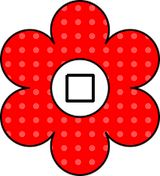

# Gardens of Io: rules in one page

Plant flowers, score points, race your Martian around the board.

      

## Goal
Have your Martian furthest along the track (40 spaces = 1 lap) when the game ends.

## Setup
- Garden: 9 × 9 circles. Track: 40 spaces around it.
- Everyone draws flowers from the bag: **2p 27 · 3p 18 · 4p 14 · 5p 11**. The rest stay in the bag (not in play).
- Players place **3 trees** on empty circles, one at a time (2 players: P1, P2, P1).
- Your Martian starts at space **0** (top-left corner).

## Your turn

| # | Step | What |
|---|------|------|
| 1 | **Special action** (optional) | Tap a counter. Max 1 per turn. |
| 2 | **Plant** | Place 1 flower on an empty circle in line with your Martian |
| 3 | **Score** | Flowers in your connected group (same colour) = points |
| 4 | **Move** | Martian goes forward that many spaces |

### 2. Plant: where?
From your Martian, a line goes straight in and **diagonally** both ways.

```
 Martian above column 4:

   ↙   ↓   ↘        any empty circle on these lines,
    ↙  ↓  ↘         up to the first tree
     ↙ ↓ ↘
```

- Trees **block** a line. Flowers do **not**.
- A corner has only the diagonal.
- No empty circle on any line? Skip planting and move **1** space.

### 3. Score
Count the flowers of the same colour touching each other **up/down/left/right** (not diagonally), including the new one.

```
 ●●        ● ●   ← the right ● is not connected
 ●         
 = 3
```

### 4. Move
Spaces with other Martians are skipped (not counted). You cannot end on an occupied space.

## Extra turn
Plant the **last flower of a colour that is in play** (none left in any reserve) → take another turn right away.

## Special actions
Each counter can be used **once in the game**. Each player may use **one** special action per game (**two** in a 2-player game).

| Icon | Action |
|------|--------|
|  | Swap a tree with a planted flower |
|  | Swap two planted flowers |
|  | Move a planted flower to an empty circle |
|  | Move a tree to an empty circle |
|  | Move your Martian 5 spaces (scores 5) |

The token you leave on a used counter shows who took it.

## End of the game
The game ends when either:
- a player has **no flowers left** (finish that turn), or
- the leading Martian is **a full lap (40 points) ahead** of the last one (at once).

Furthest Martian wins.

## Options
- **Lap bonus:** when your Martian crosses the start line, take 1 flower from the board into your reserve (not of a colour with none left in reserves).
- **Co-op:** everyone together; the score is that of the Martian furthest *behind*.

## Tips
- Plant next to your own colour to build big groups.
- Use trees and flowers as blockers: a tree on the line cuts off the circles behind it.
- Save the "move 5" counter for when it gets you past a rival.
